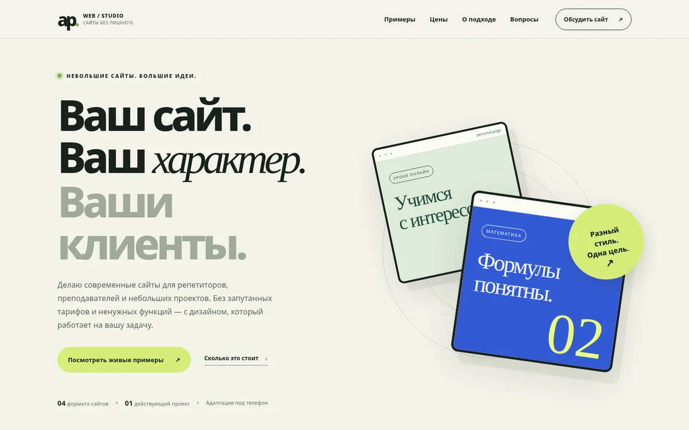

# AP Web — портфолио разработки сайтов

Интерактивное портфолио с **тремя самостоятельными дизайн-концептами и одним реализованным проектом**. Создано для показа потенциальным заказчикам небольших образовательных сайтов. Не требует backend, сборщика или платных библиотек.



## Демо и форматы

| Проект | Ссылка | Формат | Статус |
| --- | --- | --- | --- |
| Лиза. English | [Открыть](examples/english/index.html) | Сайт-визитка | Дизайн-концепт |
| Формула | [Открыть](examples/math/index.html) | Персональный сайт | Дизайн-концепт |
| КЛАСС! | [Открыть](examples/academy/index.html) | Мини-школа, каталог и демо-выбор | Дизайн-концепт |
| Alingua | [Открыть](https://apestalina-byte.github.io/alingua-demo/) | Образовательная платформа | Реализованный проект с публичным демо |

**Внимание:** три примера выше — самостоятельные концепты с вымышленными персонажами, продуктами и условиями. Они предназначены для показа дизайна и интерактивности и не являются готовыми заказами клиентов. Alingua — отдельный существующий проект; на публичной демоверсии отключены реальные платежи и серверные операции.

## Реализовано

- Главная страница портфолио с тарифами, проектами, процессом и FAQ.
- Переключение направлений в демоверсии преподавателя английского.
- Интерактивная подборка направления для математики.
- Каталог мини-школы: 8 программ, категории, поиск, сортировка, карточки, список выбранного и демонстрационное оформление.
- Демонстрационные формы, которые **не передают и не сохраняют персональные данные**.
- Кнопка связи с разработчиком: [Telegram @artem10p](https://t.me/artem10p). Форма обращения копирует текст и открывает профиль; отправка только вручную пользователем.
- Адаптивная вёрстка и мобильное меню.
- HTML/CSS/JS, отсутствие внешних библиотек и запросов к API.
- Preview-изображения настоящих страниц, полученные из рендеринга локального проекта.

## Цены

Указанные на сайте суммы **от 4 900 / 9 900 / 17 900 ₽** — предлагаемые стартовые ориентиры по ограниченному объёму, а не стоимость любой разработки. Платформы, личные кабинеты, платежи, интеграции, домен, размещение и юридическая работа оцениваются отдельно.

## Просмотр на компьютере

Откройте `index.html` в браузере. Ссылки ведут напрямую на `index.html` каждой демоверсии и работают даже при открытии с диска. Для более корректного локального HTTP-просмотра при наличии Python:

```bash
python -m http.server 8000
```

После этого адрес: `http://localhost:8000/`.

## Публикация

Архив можно разместить в корне отдельного репозитория на GitHub Pages. При загрузке в существующий репозиторий `alingua-demo` публикуйте в папку `/portfolio/` и зеркальную папку `/docs/portfolio/`, чтобы не ломать Alingua при любой из двух конфигураций Pages. Для этого подготовлен скрипт `deploy_portfolio.ps1` (поставляется отдельно от файлов сайта).

### Что обязательно настроить до коммерческого использования

1. **Telegram-контакт подключён**: [@artem10p](https://t.me/artem10p). Проверьте, что ссылка ведёт к вашему профилю.
2. Согласовать стартовые цены и состав работ.
3. Если будут настоящие формы и обработка персональных данных, отдельно настроить backend и необходимые юридические/технические меры.
4. При необходимости заменить временный нейминг `AP Web` на персональный бренд.

## Безопасность

Демосайты не содержат платежных ключей, токенов, `.env`, реальной базы пользователей или обращения к production Alingua. Никакие персональные данные не отправляются. Ссылка Alingua ведёт только на публичную демонстрационную версию.

## Разработка

Каждый пример написан на чистом HTML, CSS и JavaScript. Основной сайт не зависит от компонентов демоверсий, поэтому любой дизайн можно адаптировать под заказчика отдельно. Рекомендуется сохранять различие между концептами и реально реализованными коммерческими проектами в любых сообщениях клиентам.
